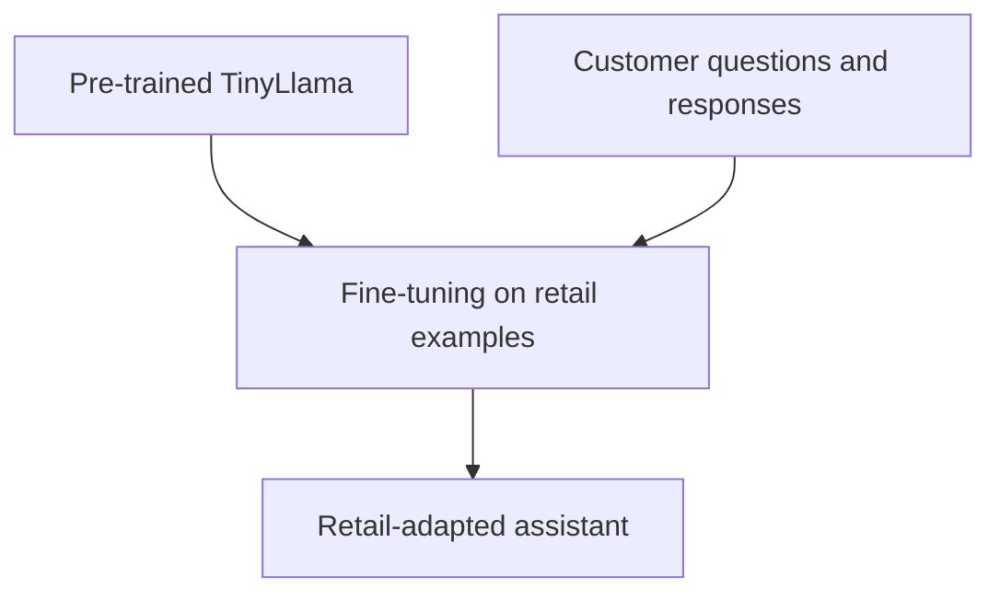
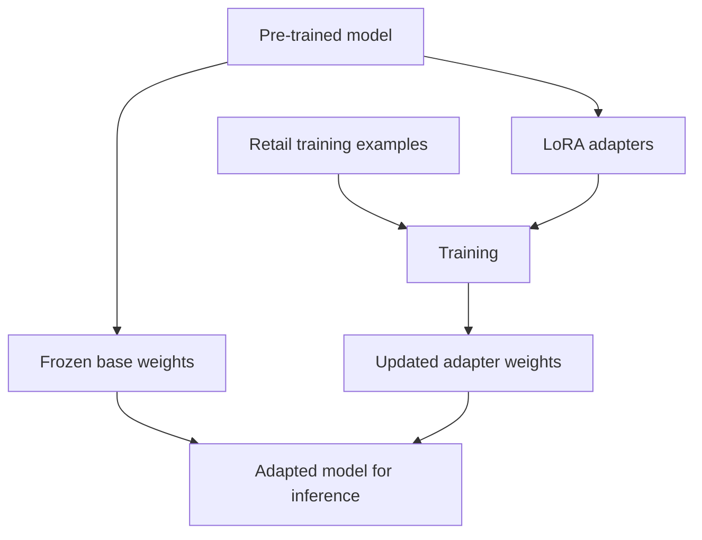
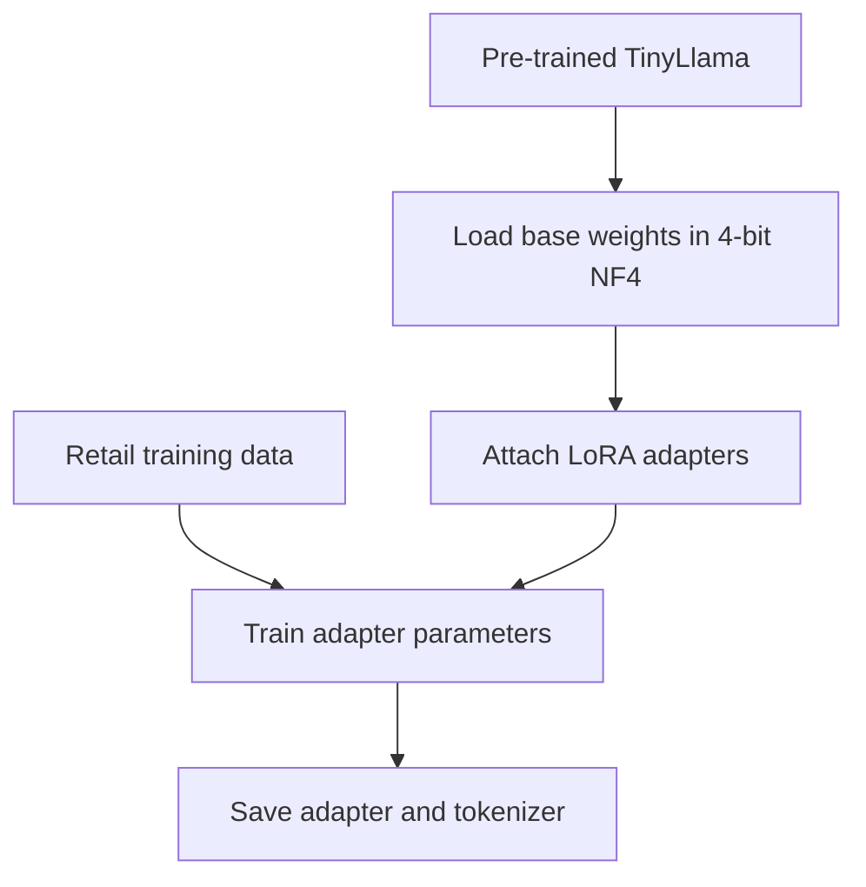
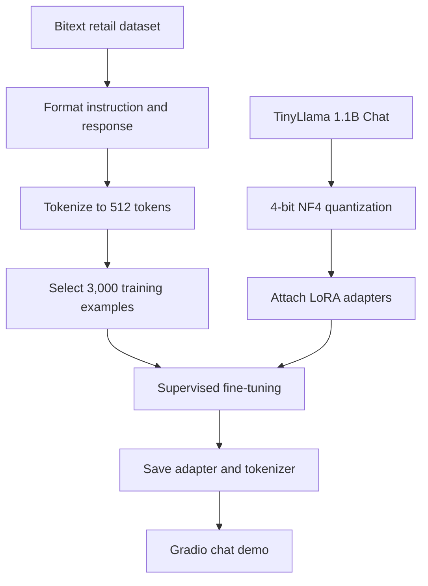
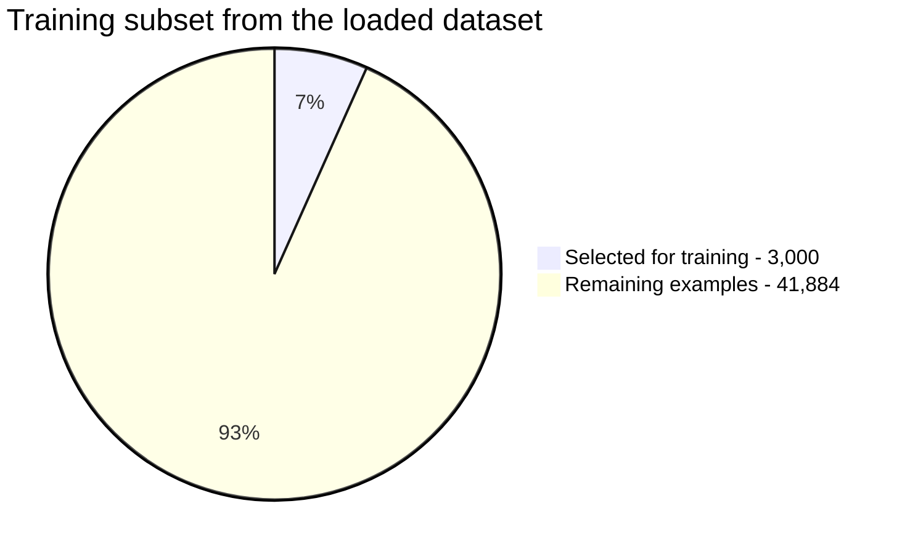
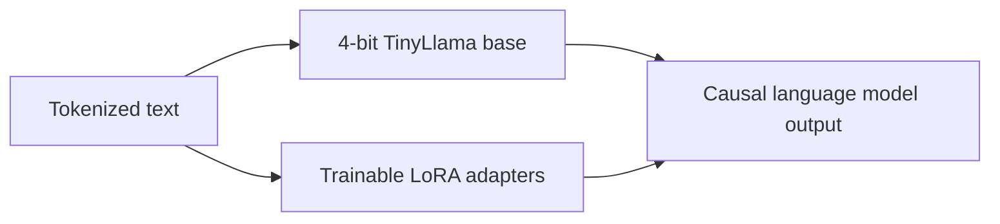
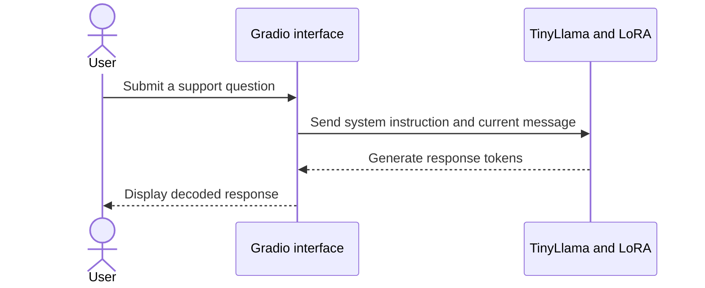

# IndustryGPT | E-commerce Customer Support Assistant

[](https://colab.research.google.com/github/amol004/IndustryGPT-Specialised-LLM-Bot-Using-Pre-Trained-Models/blob/main/IndustryGPT_Specialized_LLM_Bot_Using_Pre_Trained_Models.ipynb)

IndustryGPT is an e-commerce customer support chatbot built by fine-tuning **TinyLlama 1.1B Chat** on retail conversations. The project uses 4-bit quantization and LoRA adapters to adapt a pre-trained language model within a limited GPU memory budget, then exposes it through a Gradio chat interface.

The notebook covers the complete experiment: loading and formatting customer support data, configuring the model, supervised fine-tuning, plotting training loss, saving the adapter and tokenizer, and running an interactive demo.

| At a glance | Experiment |
| --- | --- |
| Domain | Retail and e-commerce customer support |
| Base model | `TinyLlama/TinyLlama-1.1B-Chat-v1.0` |
| Dataset | Bitext retail and e-commerce chatbot training dataset |
| Dataset size | 44,884 examples in the loaded training split |
| Training subset | First 3,000 examples after formatting and tokenization |
| Fine-tuning | LoRA adapters on a 4-bit quantized base model |
| Interface | Gradio `ChatInterface` |
| Recorded hardware | NVIDIA Tesla T4 in Google Colab |

## The problem

Customer support teams handle repeated questions about orders, delivery, carts, returns, refunds, invoices, and account management. This project explores how a general language model can be adapted to answer retail support questions in a consistent, helpful style using examples from a domain-specific dataset.

The assistant generates responses from its trained model. It does not connect to a live store database or retrieve current company policies, so it cannot verify an actual order, tracking number, or refund status.

## Understanding fine-tuning, LoRA, and QLoRA

### What is fine-tuning?

A pre-trained language model has already learned patterns from a large amount of text. **Fine-tuning** continues its training using examples for a particular task, so its responses can better match that task.

In this project, the starting model is TinyLlama 1.1B Chat. The training examples pair retail questions with customer support responses. During training, the model predicts tokens and adjusts its trainable parameters using the prediction error, called **loss**.



For example, the model sees requests such as “I want to return a damaged item” alongside examples of helpful support responses. Fine-tuning teaches it patterns in those examples; it does not give the model access to a retailer's current orders or policies.

### What is LoRA?

**LoRA** (Low-Rank Adaptation) is a method for fine-tuning a model by adding small trainable layers called **adapters** to selected parts of the model. The original model weights stay frozen while the adapters learn the task-specific changes.



This reduces the number of parameters that need to be trained and stored. IndustryGPT targets the `q_proj` and `v_proj` attention layers. The notebook reports **2,252,800 trainable parameters**, or **0.2044%** of the model's reported total.

### What is QLoRA?

**QLoRA** combines LoRA adapters with a quantized base model. **Quantization** stores model weights using fewer bits, reducing memory use. In this notebook, the base model is loaded in 4-bit NF4 format; LoRA adapters are then trained while the quantized base remains frozen.



| Approach | Base model | Parameters trained | Memory considerations |
| --- | --- | --- | --- |
| Full fine-tuning | Typically loaded at higher precision | All or most model weights | Requires optimizer state and gradients for the trained weights |
| LoRA | Base weights remain frozen | Small adapter layers | Reduces the number of trainable parameters |
| QLoRA | Frozen base weights are quantized | Small adapter layers | Reduces base model memory use as well as trainable parameters |

IndustryGPT uses the QLoRA approach: **4-bit quantization for the base model and LoRA for task-specific training**. The notebook was run with a Tesla T4 GPU. Memory use and model quality depend on the model, settings, and hardware.

## Project workflow



## Customer support scenarios

| Area | Example question |
| --- | --- |
| Delivery | “How do I track my delivery?” |
| Returns | “I want to return a damaged item.” |
| Shipping | “Can I change my shipping address after ordering?” |
| Account | “How do I close my account?” |
| Shipping options | “Do you offer express shipping?” |
| Billing | “I didn't receive my invoice.” |

These are example prompts from the notebook's Gradio interface. Responses are generated text and require verification against a real retailer's systems and policies.

## Dataset and preparation

The project loads [Bitext's retail and e-commerce chatbot training dataset](https://huggingface.co/datasets/bitext/Bitext-retail-ecommerce-llm-chatbot-training-dataset) using Hugging Face Datasets. Each source record contains an `instruction`, `response`, `category`, `intent`, and `tags` field.

| Field | Role in the source data |
| --- | --- |
| `instruction` | Customer request or question |
| `response` | Reference customer support response |
| `category` | Broad support topic |
| `intent` | Specific customer intent |
| `tags` | Additional dataset metadata |

Only `instruction` and `response` are combined into the training text. The other fields are removed from the model input. The notebook maps and tokenizes all 44,884 rows, then selects the **first 3,000** for training; the selection is not shuffled in the shown code.



Each example follows an instruction-response template:

```text
### Instruction:
Where is my order?

### Response:
You can track your order using the tracking link sent to your email.
```

The tokenizer truncates and pads examples to **512 tokens**. The notebook copies `input_ids` into `labels` for causal language modeling. In this implementation, the labels include prompt and padding tokens; response-only and padding masking are not applied.

## Model adaptation

### Quantization and LoRA

The base model is loaded with BitsAndBytes 4-bit quantization. PEFT adds LoRA adapters to the attention query and value projection layers. Training updates a small set of adapter parameters while the base model weights remain frozen.



| Configuration | Notebook value |
| --- | --- |
| Quantization | 4-bit NormalFloat (`nf4`) |
| Compute dtype | `float16` |
| Double quantization | Enabled |
| LoRA rank | `16` |
| LoRA alpha | `32` |
| LoRA dropout | `0.1` |
| Target modules | `q_proj`, `v_proj` |
| Trainable parameters | 2,252,800 of 1,102,301,184 total (**0.2044%**) |

The parameter counts are taken from the notebook's `print_trainable_parameters()` output; they are not an accuracy measurement.

### Training configuration

| Setting | Value |
| --- | --- |
| Training examples | 3,000 |
| Epochs | 2 |
| Batch size per device | 4 |
| Gradient accumulation steps | 4 |
| Effective batch size on one device | 16 examples per optimizer step |
| Learning rate | `2e-4` |
| Optimizer | `paged_adamw_8bit` |
| Mixed precision | FP16 enabled |
| Checkpoint strategy | At each epoch |
| Logging interval | Every 50 steps |

Training is configured with Hugging Face `TrainingArguments` and run with `Trainer`. The notebook saves the PEFT adapter and tokenizer to `ecommerce-chatbot/`; this is not a standalone copy of the full base model.

## Chat and inference



The interface uses a retail support system instruction and a template for the current message. Although Gradio provides a `history` argument, the notebook's response function does not add previous turns to the prompt. Each model response therefore depends on the current message rather than the chat history.

| Generation setting | Value | Purpose |
| --- | --- | --- |
| `max_new_tokens` | 250 | Limits the length of the generated response |
| `temperature` | 0.4 | Controls sampling randomness |
| `top_p` | 0.9 | Limits sampling to a probability-based token set |
| `repetition_penalty` | 1.2 | Discourages repeated text |
| `do_sample` | `True` | Enables sampling |

These settings shape generation; they do not fact-check an answer or guarantee factual accuracy.

## Training observations and evaluation

The notebook plots **training loss** from `trainer.state.log_history` across training steps. The figure is titled “Chat Bot Accuracy Over Time” in the notebook, but the plotted values are loss, not accuracy. The repository does not report a held-out evaluation set, benchmark score, or before-and-after comparison, so the plot alone cannot establish accuracy or generalization.

For a more complete evaluation, compare the base model and adapter on held-out retail questions and review response relevance, factuality, policy compliance, and behavior when order information is unavailable. Consider masking padding and instruction tokens in the training loss and reviewing how the first 3,000 selected rows represent the dataset's categories before drawing conclusions.

## Technology stack

| Technology | Use in this project |
| --- | --- |
| Python | Notebook implementation and data preparation |
| PyTorch | Tensors, model execution, and inference |
| Hugging Face Transformers | TinyLlama model, tokenizer, quantization configuration, `Trainer`, and generation |
| Hugging Face Datasets | Dataset loading, mapping, and selection |
| PEFT | LoRA configuration and adapter training |
| BitsAndBytes | 4-bit model loading and 8-bit optimizer support |
| Accelerate | Device placement support |
| pandas | Previewing dataset and tokenized records |
| Matplotlib and seaborn | Notebook visualization imports; Matplotlib plots training loss |
| Gradio | Interactive chat interface |
| Google Colab | Notebook runtime and optional GPU environment |

`trl` is installed in the notebook; the training code uses Transformers `Trainer`.

## Run the notebook

1. Open the [notebook in Google Colab](https://colab.research.google.com/github/amol004/IndustryGPT-Specialised-LLM-Bot-Using-Pre-Trained-Models/blob/main/IndustryGPT_Specialized_LLM_Bot_Using_Pre_Trained_Models.ipynb).
2. Select a GPU runtime. The recorded experiment used a Tesla T4; availability and runtime limits depend on Colab.
3. Install the notebook dependencies. Include Gradio if it is not already available in the runtime:

   ```python
   !pip install -q transformers datasets peft bitsandbytes accelerate trl gradio pandas matplotlib seaborn
   ```

4. The notebook reads a Hugging Face token from a Colab secret named `HF_TOKEN`. Add that secret if using the login cell, and do not put the token in the notebook or repository.
5. Run the cells in order to load and format the dataset, configure the model, train the adapter, and launch the Gradio interface.

The demo uses `share=True`; the public URL printed by Gradio is temporary. The repository does not include a permanent deployment URL, trained adapter files, or a pinned dependency manifest.

## Repository contents

| File | Description |
| --- | --- |
| `IndustryGPT_Specialized_LLM_Bot_Using_Pre_Trained_Models.ipynb` | Data preparation, model configuration, training, loss plot, saving, and Gradio demo |
| `README.md` | Project overview and usage guide |
| `.gitignore` | Files and directories excluded from version control |

## Limitations and next steps

- Connect to an authorized order or policy source before answering questions that require live customer data.
- Add a held-out test split and compare the adapted model with the base model using repeatable evaluation prompts.
- Mask padding and, if training on responses only is intended, instruction tokens in the loss labels.
- Examine category and intent coverage when choosing the training subset.
- Pass conversation history to the model if multi-turn context is required.
- Pin and test dependency versions, save the adapter as a reusable artifact, and document a reproducible deployment path.

## Author

**Amol Thakur** · [GitHub](https://github.com/amol004)